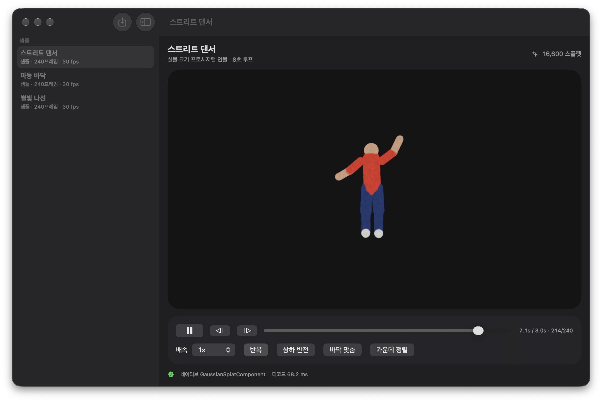
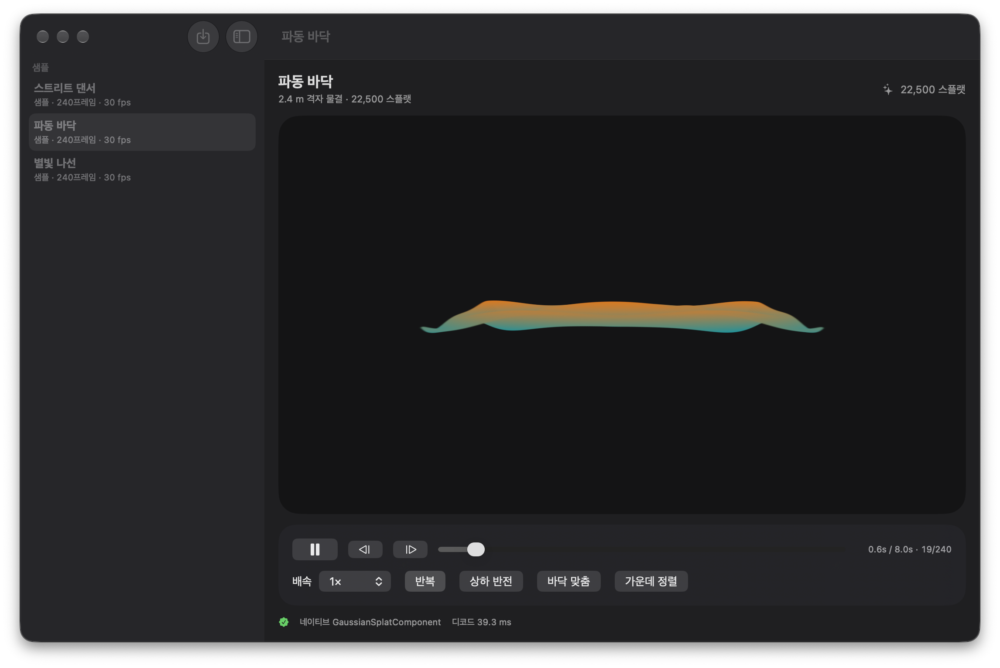
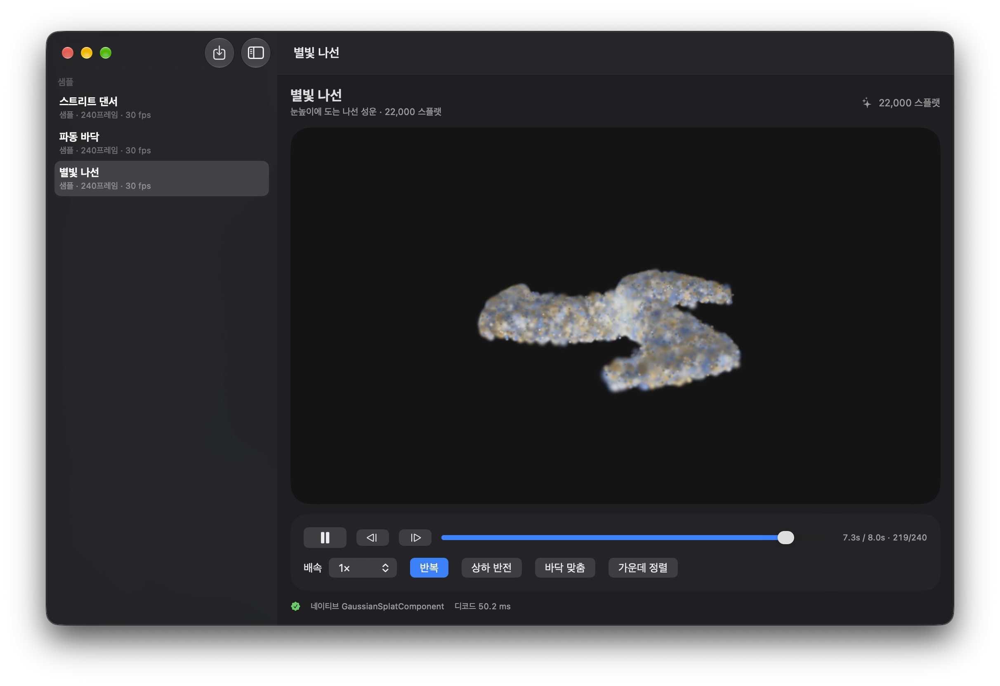

<p align="center">
  
</p>

<h1 align="center">무대 (Mudae)</h1>
<p align="center"><b>Apple Vision Pro 를 위한 4D 가우시안 스플랫 볼류메트릭 뷰어</b><br>
Gracia 처럼, 움직이는 3D 캡처를 내 방에 실물 크기로 세워 두고 걸어 다니며 본다.</p>

<p align="center">
  
  
  
  
</p>

---

## 무엇을 하는 앱인가

| | |
|---|---|
| **완전 볼류메트릭** | 스테레오 영상이 아니라 임의 시점. 패스스루 위에 두고(내 방) 걸어 다니거나, 장면 속으로 들어간다(완전 몰입). |
| **4D(시간축)** | 정지 스캔이 아니라 움직이는 캡처. 재생·일시정지·탐색·배속·반복. |
| **두 개의 렌더 경로** | ① RealityKit 27 네이티브 `GaussianSplatComponent` — PLY 한 장·PLY 프레임 폴더·프로시저럴 샘플. ② Gracia SDK 자체 Metal 렌더러 — `.mint` 4DGS 볼류메트릭 영상 스트리밍. |
| **가져오기** | `.ply`(3DGS), PLY 시퀀스 폴더, `.mint`, `.sog`. |

<table>
  <tr>
    <td></td>
    <td></td>
  </tr>
  <tr>
    <td align="center">파동 바닥 · 22,500 스플랫 · 30 fps</td>
    <td align="center">별빛 나선 · 22,000 스플랫 · 8초 루프</td>
  </tr>
</table>

> macOS 창에서 네이티브 `GaussianSplatComponent` 로 실제 렌더링한 화면입니다. Gracia 데모 콘텐츠는 라이선스상 공개 게시가 금지돼 스크린샷을 싣지 않았습니다.

## 빠르게 써 보기

1. Xcode 26.3+ 로 `gaussianTest.xcodeproj` 를 연다. Swift Package Manager 가 [gracia-labs/apple-sdk](https://github.com/gracia-labs/apple-sdk) 를 자동으로 받는다(첫 빌드에 네트워크 필요).
2. 대상을 **My Mac** 또는 **Apple Vision Pro(실기기)** 로 고른다. 시뮬레이터는 지원하지 않는다(아래 "왜 시뮬레이터가 없나").
3. 실행하면 사이드바에 세 그룹이 보인다.
   - **샘플** — 프로시저럴 4D 장면 3종. 외부 파일 없이 재생 경로를 확인한다.
   - **Gracia 데모** — Gracia 가 공개한 4DGS 볼류메트릭 영상 10편을 Gracia 인프라에서 스트리밍한다(평가 용도).
   - **가져온 항목** — 툴바의 가져오기로 넣은 파일.
4. Vision Pro 에서는 "내 방에 배치" 또는 "완전 몰입"을 누른다. RealityKit 무대는 드래그로 옮기고 핀치로 키운다. Gracia 무대는 한 손 핀치로 옮기고 두 손 핀치로 키우거나 돌린다.

```sh
# 명령줄 빌드(서명 없이 컴파일만)
xcodebuild -project gaussianTest.xcodeproj -scheme gaussianTest \
  -destination 'generic/platform=visionOS' CODE_SIGNING_ALLOWED=NO build
xcodebuild -project gaussianTest.xcodeproj -scheme gaussianTest \
  -destination 'platform=macOS' build
```

DEBUG 빌드는 `-scene N` 인자로 시작 장면을, `-switchTo M -switchAfter S` 로 자동 전환을 지정할 수 있다(스크린샷 자동화용).

## 구조

```
gaussianTest/
├─ Splat/        SplatCloud(16 float/스플랫 인터리브) · PLYSplatParser · SplatSource(파일·시퀀스·프로시저럴) · SplatPlayer
├─ Render/       SplatRenderer — 네이티브 GaussianSplatComponent + LowLevelBuffer 재사용
├─ Gracia/       Gracia SDK 통합 — 카탈로그 · RenderLink · Compositor Services 렌더러(visionOS) · SplatsSceneView 래퍼(macOS)
├─ Views/        StageView(RealityView) · PlayerControlsView · GraciaDetailView · ImmersiveStageView
├─ App/          AppModel(라이브러리·선택·가져오기)
└─ MyApp.swift   WindowGroup + ImmersiveSpace ×2 (RealityKit 무대 / Gracia 무대)
Docs/            TechPRD.md · Tasks.md · screenshots/
```

### 경로 ① RealityKit 네이티브 스플랫

- 스플랫 하나 = `Float` 16개(64 B): 위치 3 · log 스케일 3 · 회전 4(w, x, y, z) · logit 불투명도 1 · SH0 색 3 · 패딩 2. `GaussianSplatResource.BufferDescriptor` 가 이 레이아웃을 그대로 참조하므로 복사는 한 번뿐이다.
- 4D 재생은 `LowLevelBuffer` 하나를 최대 용량으로 잡고 프레임마다 `withUnsafeMutableBytes` 로 덮어쓴다. 프레임마다 스플랫 수가 달라도 남는 슬롯을 숨길 뿐 리소스를 다시 만들지 않는다.
- 플레이어는 `ContinuousClock` 기준 시각으로 목표 프레임을 계산해 드리프트가 없다.
- PLY 파서는 3DGS 표준 속성(`x y z`, `scale_0..2`, `rot_0..3`, `opacity`, `f_dc_0..2`)과 ascii / binary LE·BE 를 지원한다. 색이 `red/green/blue` 뿐인 포인트클라우드도 SH0 로 바꿔 받는다.

### 경로 ② Gracia SDK

- `.mint` 는 Gracia 의 독점 4DGS 컨테이너다. 디코더·렌더러는 바이너리 xcframework 로만 제공되며, Gracia 의 CONTENT-LICENSE 는 포맷 변환·스플랫 추출을 금지한다. 그래서 **우리 RealityKit 경로로 옮기지 않고 Gracia 렌더러를 그대로 쓴다.**
- macOS: `SplatsSceneView` 를 `NSViewRepresentable` 로 끼웠다. 드래그 궤도 · 스크롤 줌 · WASD 비행.
- visionOS: Gracia 의 MIT 데모(`AVP/Sources`)를 포팅했다. `CompositorLayer` 렌더 루프가 눈별 projection 과 디바이스 앵커로 `RenderView` 두 개를 만들고, 멀티뷰 정점 증폭 한 번으로 2 슬라이스 레이어드 텍스처에 양안을 그린다. 메인 액터와 렌더 스레드는 잠금 보호 우편함(`GraciaRenderLink`)으로만 통신한다.
- 데모 카탈로그는 Gracia 스트리밍 엔드포인트 + 공개 데모 토큰을 쓴다. 직접 링크(gstatic)는 Cloudflare 챌린지로 403 을 돌려줘 쓸 수 없었다.

## 지원 포맷

| 포맷 | 경로 | 비고 |
|---|---|---|
| `.ply` (3DGS) | RealityKit | SH 0차만. COLMAP 계열은 "상하 반전" 토글(기본 켬) |
| PLY 프레임 폴더 | RealityKit | 이름순 정렬, LRU 12프레임, 프리페치 2. 선택 `sequence.json { "fps": 24, "flipY": true }` |
| `.mint` (4DGS 영상) | Gracia | 로컬 파일 또는 HTTPS 스트림 |
| `.sog` (정지) | Gracia | |

## 검증 상태

| 항목 | 상태 |
|---|---|
| 빌드 — My Mac, Any visionOS Device | ✅ 경고 0 |
| macOS — 샘플 3종 네이티브 스플랫 재생 | ✅ 스크린샷 참조 |
| macOS — Gracia 데모 10편 중 2편 스트리밍 재생 (의사·패션) | ✅ 60–70 fps, 10만–28만 스플랫/프레임 |
| macOS — 장면 전환(RealityKit ↔ Gracia, 샘플 간) | ✅ 자동 전환 시나리오로 확인 |
| Vision Pro 실기기 — 두 몰입 공간, 제스처 | 🧪 미검증 |
| 외부 3DGS PLY · PLY 시퀀스 폴더 실측 | 🧪 미검증 |

### 왜 시뮬레이터가 없나

- visionOS 시뮬레이터 SDK 에는 `GaussianSplatResource` 타입 자체가 없다(실기기·macOS SDK 에만 있음, `@available(visionOS 27, macOS 27, iOS 27)`).
- Gracia 의 xcframework 에는 시뮬레이터 슬라이스가 없다(macos-arm64 · ios-arm64 · xros-arm64 만).
- 그래서 타깃은 `macosx xros` 로 좁혔고, 개발 중 시각 검증은 macOS 창에서 한다.

## 로드맵

자세한 내용은 [Docs/TechPRD.md](Docs/TechPRD.md) 와 [Docs/Tasks.md](Docs/Tasks.md).

- **M1** 실기기 QA, 접지 그림자, LiDAR 바닥 스냅, 고차 SH, 단위 테스트
- **M2** 시퀀스 성능(프리페치·컬링·적응 품질)
- **M3** 자체 컨테이너 `.mudae`(키프레임 + 델타) + HTTP range 스트리밍
- **M4** 원격 카탈로그, 공간 오디오

## 라이선스와 고지

- 이 저장소의 코드는 **Apache License 2.0** 이다([LICENSE](LICENSE), [NOTICE](NOTICE)).
- `gaussianTest/Gracia/` 의 일부 파일은 [gracia-labs/apple-sdk](https://github.com/gracia-labs/apple-sdk) visionOS 데모(MIT, © 2026 Gracia Labs and contributors)를 포팅했다. Gracia 렌더러 바이너리는 빌드 시 SwiftPM 으로 받으며 이 저장소에 포함하지 않는다.
- **Gracia 데모 콘텐츠**는 이 저장소에 없다. 앱은 URL 만 갖고 있으며, 콘텐츠는 Gracia 의 [CONTENT-LICENSE](https://github.com/gracia-labs/apple-sdk/blob/main/CONTENT-LICENSE) 에 따라 **시연·평가 용도로만** 재생할 수 있다. 재배포·변환·스플랫 추출·공개 배포는 허용되지 않는다. `.gitignore` 가 `*.mint` 를 막는다.
- 이름 "무대(Mudae)" 와 번들 ID `com.coulson.Mudae` 는 임시다.

## 참고

- [Gaussian splats on visionOS — Apple 샘플](https://developer.apple.com/documentation/visionos/gaussian-splats-on-visionos) · [WWDC26 279: Explore advances in RealityKit](https://developer.apple.com/videos/play/wwdc2026/279/)
- [Gracia: 4DGS viewer (App Store)](https://apps.apple.com/us/app/gracia-4dgs-viewer/id6773024890) · [Gracia Apple SDK](https://github.com/gracia-labs/apple-sdk) · [Gracia demo data](https://docs.gracia.ai/demo-data)
- [4D Gaussian Splatting (Radiance Fields)](https://radiancefields.com/4d-gaussian-splatting) · [avala-ai/4dgs 열린 컨테이너 포맷](https://github.com/avala-ai/4dgs)
